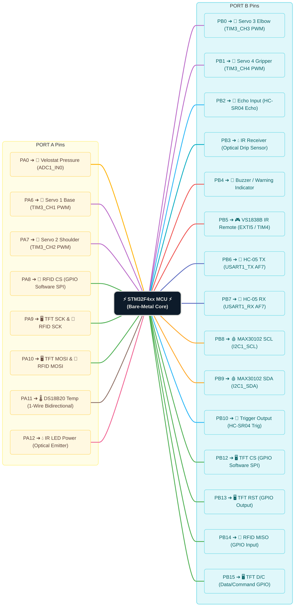
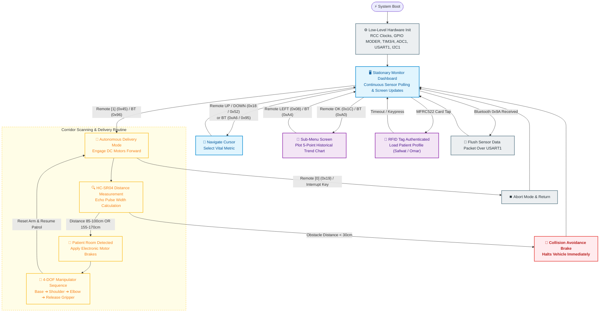

# 🏥 Autonomous Smart Nurse Robot
### **Full Bare-Metal ARM Cortex-M Assembly Medical Robotics System**
*Developed at Cairo University — Faculty of Engineering (Computer Engineering)*

[-E65C00?style=for-the-badge)](README.md)
[-red?style=for-the-badge)](README.md)

 

> **An autonomous hospital assistant robot engineered from register level up in pure ARM Cortex-M4 Assembly without HAL, standard C libraries, or RTOS. The system features real-time vital sign monitoring (Photoplethysmography DSP, 1-Wire temperature, piezoresistive pressure), optical IV drip rate calculation, RFID patient profile lookup, a custom-rendered SPI color GUI, corridor distance scanning, 4-DOF medicine delivery, and bidirectional Bluetooth telemetry.**

---

## 📑 Table of Contents
- [📸 System Hardware Showcase](#-system-hardware-showcase)
- [🌟 Key Engineering Innovations](#-key-engineering-innovations)
- [🧩 Subsystem Architecture & Low-Level Drivers](#-subsystem-architecture--low-level-drivers)
  - [1. Custom Graphical Dashboard (ST7735 TFT)](#1-custom-graphical-dashboard-st7735-tft)
  - [2. DSP Vitals Processing (MAX30102 PPG)](#2-dsp-vitals-processing-max30102-ppg)
  - [3. Optical IV Drop Rate Monitoring System](#3-optical-iv-drop-rate-monitoring-system)
  - [4. Patient Authentication & Clinical Profiles (MFRC522 RFID)](#4-patient-authentication--clinical-profiles-mfrc522-rfid)
  - [5. Cycle-Accurate 1-Wire Temperature (DS18B20)](#5-cycle-accurate-1-wire-temperature-ds18b20)
  - [6. Piezoresistive Bed Pressure Sensing (Velostat ADC)](#6-piezoresistive-bed-pressure-sensing-velostat-adc)
  - [7. Autonomous Navigation & 4-DOF Manipulator](#7-autonomous-navigation--4-dof-manipulator)
- [📡 Wireless Telemetry & Control Protocols](#-wireless-telemetry--control-protocols)
  - [Bluetooth USART Telemetry & Command Set](#bluetooth-usart-telemetry--command-set)
  - [Infrared Remote Decoder (NEC Protocol)](#infrared-remote-decoder-nec-protocol)
- [📌 STM32 Pinout & Trace Routing Map](#-stm32-pinout--trace-routing-map)
- [🔌 Hardware Bill of Materials (BOM) & Electrical Specs](#-hardware-bill-of-materials-bom--electrical-specs)
- [🧠 Firmware State Machine & Workflow](#-firmware-state-machine--workflow)
- [📁 Modular Assembly Source Code Structure](#-modular-assembly-source-code-structure)
- [🚀 Build & Getting Started Guide (Keil uVision 5)](#-build--getting-started-guide-keil-uvision-5)
- [👥 Workload Distribution & Team Credits](#-workload-distribution--team-credits)

---

## 📸 System Hardware Showcase

  <table>
    <tr>
      <th align="center" width="33%"><b>Front View & Robotic Arm</b></th>
      <th align="center" width="33%"><b>Electronics Bay & Chassis Wiring</b></th>
      <th align="center" width="33%"><b>Nurse Station Mobile App</b></th>
    </tr>
    <tr>
      <td align="center" valign="top">
        
         
        <b>Chassis Front:</b> ST7735 1.8" Color TFT, Ultrasonic sensor, 4-DOF delivery arm, and IR drop counter.
      </td>
      <td align="center" valign="top">
        
         
        <b>Electronics Bay:</b> STM32F4xx board, sensor breakout array, level shifters, and power distribution bus.
      </td>
      <td align="center" valign="top">
        
         
        <b>Mobile Telemetry:</b> Live vital signs stream, remote navigation triggers, and alert dashboard.
      </td>
    </tr>
  </table>

---

## 🌟 Key Engineering Innovations

* ⚡ **100% Pure Bare-Metal Assembly:** Every peripheral driver (SPI, I2C, USART, ADC, 1-Wire, TIM, EXTI, SysTick) is written directly using direct memory-mapped register manipulation with zero compiler abstractions or HAL overhead.
* 💧 **Autonomous Optical IV Drop Rate Gate:** Custom-designed IR optocoupler gate measuring real-time IV drip velocity (Drops/Min) with automated debouncing, falling-edge filtering, target comparison, and audiovisual alarms.
* 🩸 **Register-Level DSP for Pulse Oximetry:** Directly pulls raw photoplethysmogram (PPG) FIFO data from the MAX30102 via register-level I2C, implementing hardware-accelerated integer mathematics (`UDIV`, `MUL`) to extract BPM and $SpO_2$.
* 🪪 **On-Chip Patient Authentication:** Bit-banged SPI engine interfacing with MFRC522 to read ISO14443A card UIDs and query on-chip clinical records (Name, Age, History, Baseline Vitals) on the display.
* 🦾 **Coordinated 4-DOF Robotic Delivery Arm:** Hardware PWM generation across 4 timer channels (TIM3 CH1-CH4) at 50Hz, orchestrating multi-step autonomous medicine payload dispensing inside patient rooms.
* 📱 **Bidirectional IoT Telemetry:** Full-duplex USART telemetry streaming formatted clinical frames to an Android app with bidirectional command reception for remote maneuvering.

---

## 🧩 Subsystem Architecture & Low-Level Drivers

### 1. Custom Graphical Dashboard (ST7735 TFT)
* **Driver Source:** [`TFT.s`](TFT.s) | **Orchestration:** [`main.s`](main.s)
* **Interface:** Bit-Banged SPI (`PA9` SCK, `PA10` MOSI, `PB12` CS, `PB13` RST, `PB15` A0/DC)
* **Architecture:**
  - Implements low-overhead bit-banging routines (`SPI_Write_Byte`) toggling GPIO pins via `GPIOA_BSRR` and `GPIOB_BSRR` for single-cycle atomic updates.
  - Features memory-mapped font glyph lookup tables, color conversion (RGB565 16-bit format), rectangular clipping window definition (`CASET`/`RASET`), and coordinate-based string drawing.
  - Multi-state GUI engine supporting 3 primary display layouts:
    1. **Live Health Overview:** Real-time sensor readout dashboard.
    2. **Clinical Trend History:** Graphing past 5 readings for BPM, $SpO_2$, Pressure, and Room Temperature.
    3. **Patient Profile Card:** Displays authenticated patient demographic data upon RFID swipe.

### 2. DSP Vitals Processing (MAX30102 PPG)
* **Driver Source:** [`max.s`](max.s)
* **Interface:** I2C1 (`PB8` SCL, `PB9` SDA)
* **Architecture:**
  - Configures the MAX30102 internal registers: FIFO write pointer, configuration register (sample averaging = 4, ADC range = 4096nA, sample rate = 100Hz, pulse width = 411µs), and LED power levels.
  - Periodically reads the 6-byte FIFO data burst containing 18-bit Red and IR values.
  - Computes peak-to-peak amplitude differences and alternating current (AC) vs direct current (DC) ratios to calculate blood oxygen saturation percentage ($SpO_2$) and pulses per minute (Heart Rate) directly in ARM registers without floating-point emulation.

### 3. Optical IV Drop Rate Monitoring System
* **Driver Source:** [`DROP rate.s`](DROP%20rate.s)
* **Interface:** `PA12` (IR Emitter Enable), `PB3` (IR Phototransistor Input), `PB4` (Alarm Buzzer / LED)
* **Architecture:**
  - The drop chamber is positioned between an IR LED and a phototransistor. When a fluid droplet falls, it attenuates the optical beam, creating a rising/falling edge transition on `PB3`.
  - The assembly algorithm implements temporal debounce filtering to eliminate multi-triggering from fluid meniscus vibrations.
  - Time between drops is tracked against a system counter. The current drop rate ($DPM = \frac{60}{\Delta t}$) is calculated and compared to the target threshold (`desired_drop_rate`). If the rate drops below acceptable clinical thresholds or ceases entirely, `PB4` strobes the acoustic buzzer.

### 4. Patient Authentication & Clinical Profiles (MFRC522 RFID)
* **Driver Source:** [`RFID.s`](RFID.s)
* **Interface:** Bit-Banged SPI (`PA8` CS, `PA9` SCK, `PA10` MOSI, `PB14` MISO)
* **Architecture:**
  - Direct software implementation of the Philips/NXP MFRC522 register protocol: soft reset, antenna gain configuration, and CRC coprocessor initialization.
  - Executes the ISO14443A collision-resolution cascade: transmits `REQA` (0x26), polls for `ATQA`, executes `PICC_ANTICOLL` (0x93 0x20), and captures the 4-byte Card Unique Identifier (UID).
  - In-memory clinical lookup table:
    * **Tag `0x031F39CA`:** Patient: **SAFWAT** | Age: **19** | Profile: Post-Op Care.
    * **Tag `0x023338E6`:** Patient: **OMAR** | Age: **21** | Profile: Intensive Monitoring.

### 5. Cycle-Accurate 1-Wire Temperature (DS18B20)
* **Driver Source:** [`temperature.s`](temperature.s)
* **Interface:** `PA11` (Open-Drain Bidirectional Data Line with 4.7kΩ external pull-up)
* **Architecture:**
  - Implements strict Dallas 1-Wire microsecond timing constraints tuned for a 16 MHz core clock:
    * **Reset Pulse:** Master pulls line LOW for 480µs, releases, then polls for the 60–240µs slave Presence Pulse.
    * **Write 0 / Write 1 Slots:** Master pulls line LOW for 60µs vs 10µs with precise NOP-padded delay loops.
    * **Read Time Slots:** Master pulls line LOW for 2µs, releases, and samples line level at exactly 12µs.
  - Sends `SKIP ROM` (`0xCC`) followed by `CONVERT T` (`0x44`), waits for conversion, issues `READ SCRATCHPAD` (`0xBE`), and extracts the 16-bit signed temperature value.

### 6. Piezoresistive Bed Pressure Sensing (Velostat ADC)
* **Driver Source:** [`velostat.s`](velostat.s)
* **Interface:** ADC1 Channel 0 (`PA0`)
* **Architecture:**
  - Configures STM32F4 ADC1: 12-bit resolution, single-conversion mode, software trigger (`SWSTART`), right-aligned data.
  - Interfaced with a voltage divider utilizing a conductive piezoresistive Velostat matrix. As mechanical patient pressure increases, electrical resistance decreases proportionally.
  - The driver initiates sampling, polls the End of Conversion (`EOC`) flag in `ADC_SR`, and reads the digital value from `ADC_DR`.

### 7. Autonomous Navigation & 4-DOF Manipulator
* **Driver Source:** [`Robot_mode.s`](Robot_mode.s), [`arm.s`](arm.s), [`ultrasonic.s`](ultrasonic.s)
* **Interface:**
  - **Ultrasonic HC-SR04:** `PB10` (Trigger Output), `PB2` (Echo Input)
  - **DC Drive Motors:** `GPIOA_ODR` bits via H-Bridge driver
  - **4-DOF Robotic Arm:** `TIM3` PWM (`PA6` Base, `PA7` Shoulder, `PB0` Elbow, `PB1` Gripper)
* **Architecture:**
  - **Distance Measurement:** Generates a 10µs HIGH pulse on `PB10`. Listens for the rising edge on `PB2`, counts microsecond clock ticks until the falling edge occurs, and applies division by 58 ($Distance_{cm} = \frac{Echo_{time}}{58}$).
  - **Corridor Navigation Machine:**
    * `Distance > 170 cm`: Clear corridor — drives forward.
    * `85 cm ≤ Distance ≤ 100 cm` OR `155 cm ≤ Distance ≤ 170 cm`: Specific patient room door detected. Engages electronic motor brakes and triggers medicine drop-off.
    * `Distance < 30 cm`: Emergency obstacle safety brake engaged to prevent collision.
  - **Robotic Delivery Routine:** Timer `TIM3` is configured with a 20ms period (50Hz PWM). A sequential sub-routine manipulates `TIM3_CCR1` through `TIM3_CCR4` to extend the arm, lower the elbow, open the gripper to deposit medication on the bedside tray, and re-stow into home position.

---

## 📡 Wireless Telemetry & Control Protocols

### Bluetooth USART Telemetry & Command Set
* **Driver Source:** [`bluetooth.s`](bluetooth.s)
* **Hardware Config:** USART1 configured on `PB6` (TX) and `PB7` (RX) at **9600 Baud** (BRR = `0x0683` with 16 MHz APB2 clock).
* **Communication Paradigm:** The mobile nurse application acts as an inquiry master, communicating with the robot over a structured hex command protocol:

| Command (Hex) | Direction | Subroutine Handler | Description / Response |
| :---: | :---: | :---: | :--- |
| `0x9A` | App ➔ Robot | `BT_Send_Sensor_Data` | **Telemetry Dump:** Streams full live vitals packet: `HR:<bpm> SpO2:<spo2> Press:<press> RTemp:<temp> Drop:<drop>\r\n` |
| `0xA6` | App ➔ Robot | `bt_up` | Navigates the active TFT dashboard cursor **UP** |
| `0x95` | App ➔ Robot | `bt_down` | Navigates the active TFT dashboard cursor **DOWN** |
| `0xA4` | App ➔ Robot | `bt_left` | Performs **BACK / CANCEL** operation to parent menu |
| `0xA0` | App ➔ Robot | `bt_ok` | **CONFIRM / ENTER** selection into sub-menu or log view |
| `0x96` | App ➔ Robot | `Enter_Robot_Mode` | Transitions robot from stationary monitoring into **Autonomous Delivery Mode** |
| `0x99` | App ➔ Robot | `BUTTON_2` | Quick-select metric: Heart Rate & SpO2 analytics |
| `0x8C` | App ➔ Robot | `BUTTON_4` | Quick-select metric: Temperature log |
| `0x98` | App ➔ Robot | `BUTTON_5` | Quick-select metric: Bed Pressure sensor |
| `0xBE` | App ➔ Robot | `BUTTON_6` | Quick-select metric: IV Drip Rate configuration |

### Infrared Remote Decoder (NEC Protocol)
* **Driver Source:** [`IR.s`](IR.s)
* **Hardware Config:** VS1838B optical receiver demodulator connected to `PB5` (EXTI5 interrupt & TIM4 timebase).
* **Decoding Logic:** Decodes 38kHz modulated signals using the NEC transmission protocol. Detects the 9ms leading pulse burst + 4.5ms space, followed by 32 bits (8-bit address, 8-bit inverted address, 8-bit command, 8-bit inverted command):

| Remote Key | NEC Hex Code | System Action |
| :---: | :---: | :--- |
| ⬆️ **UP** | `0x18` | Move selection UP in dashboard |
| ⬇️ **DOWN** | `0x52` | Move selection DOWN in dashboard |
| ⬅️ **LEFT** | `0x08` | Back to main monitoring view |
| ➡️ **RIGHT** | `0x5A` | Shift view / Navigate right |
| 🆗 **OK** | `0x1C` | Enter selected sensor history screen |
| 1️⃣ **[ 1 ]** | `0x45` | Launch Autonomous Corridor Patrol & Medicine Delivery |
| 0️⃣ **[ 0 ]** | `0x19` | Emergency Stop / Return to Station Mode |

---

## 📌 STM32 Pinout & Trace Routing Map

---

## 🔌 Hardware Bill of Materials (BOM) & Electrical Specs

| Subsystem / Part | Component Model | Logic Voltage | Power Rail | Interface / Pins | Pull-Up / External Passive Notes |
| :--- | :--- | :---: | :---: | :--- | :--- |
| **Microcontroller** | STM32F4xx Core Board | 3.3V | 3.3V LDO / 5V USB | All GPIO / Busses | Decoupling capacitors (100nF) on VDD pins. |
| **Color Display** | ST7735 1.8" TFT SPI | 3.3V | 3.3V | PA9, PA10, PB12, PB13, PB15 | Current limiting resistor on LED backlight anode. |
| **Pulse Oximeter** | MAX30102 PPG Sensor | 3.3V / 1.8V | 3.3V | PB8 (SCL), PB9 (SDA) | **10kΩ pull-up resistors** required on I2C lines. |
| **Temperature Sensor**| Maxim DS18B20 | 3.0V - 5.5V | 3.3V | PA11 (DQ) | **4.7kΩ pull-up resistor** to 3.3V on DQ 1-Wire line. |
| **RFID Reader** | MFRC522 (13.56 MHz) | 3.3V | 3.3V | PA8, PA9, PA10, PB14 | 3.3V strictly required (Not 5V tolerant on VCC). |
| **Ultrasonic Distance**| HC-SR04 | 5.0V | 5.0V | PB10 (Trig), PB2 (Echo) | Echo pin requires 5V-to-3.3V resistor divider to protect PB2. |
| **Bed Pressure Sensor**| Velostat Sheet + Divider| Analog | 3.3V | PA0 (ADC1_IN0) | 10kΩ precision fixed resistor in series divider. |
| **Optical IV Gate** | IR LED + Phototransistor | 3.3V / 5V | 3.3V | PA12 (Drive), PB3 (In), PB4 (Alarm) | 220Ω resistor on IR LED, 10kΩ pull-up on phototransistor collector. |
| **Wireless Telemetry**| HC-05 Bluetooth Module | 3.3V / 5.0V | 5.0V | PB6 (TX), PB7 (RX) | Module VCC powered via 5V rail; UART logic compatible with 3.3V. |
| **IR Demodulator** | VS1838B (38 kHz) | 3.3V - 5V | 3.3V | PB5 (Signal) | Built-in pull-up with external bypass capacitor. |
| **Robotic Arm Servos**| 4x TowerPro SG90 | 4.8V - 6.0V | **External 5V / 2A** | PA6, PA7, PB0, PB1 (TIM3) | **Isolate servo power from MCU rail** to prevent brownout resets. |

---

## 🧠 Firmware State Machine & Workflow

---

## 📁 Modular Assembly Source Code Structure

The entire codebase is structured in modular `.s` Assembly source files with clear register abstractions and calling conventions:

| Source File | Description & Subroutines | Target Peripherals & Hardware Pins |
| :--- | :--- | :--- |
| 📜 [`main.s`](main.s) | Primary supervisor loop, system clock configuration (16MHz), GUI state machine, history buffers, and event dispatcher. | ST7735 TFT GUI, System Timers |
| 📜 [`max.s`](max.s) | Low-level I2C1 transactions, MAX30102 register configuration, sample FIFO extraction, and BPM/$SpO_2$ integer math. | I2C1 (`PB8` SCL, `PB9` SDA) |
| 📜 [`RFID.s`](RFID.s) | Software SPI driver for MFRC522 RFID, ISO14443A anti-collision protocol, and in-memory patient database lookup. | Bit-Banged SPI (`PA8`, `PA9`, `PA10`, `PB14`) |
| 📜 [`Robot_mode.s`](Robot_mode.s) | Autonomous navigation machine, ultrasonic obstacle threshold evaluation, motor drive signals, and arm sequence invocation. | `GPIOA_ODR` (Motors), Ultrasonic logic |
| 📜 [`arm.s`](arm.s) | Timer 3 initialization for 4-channel 50Hz PWM output and position routines for the 4-DOF SG90 manipulator. | TIM3 (`PA6` Base, `PA7` Shoulder, `PB0` Elbow, `PB1` Gripper) |
| 📜 [`bluetooth.s`](bluetooth.s) | USART1 driver at 9600 Baud. Handles incoming query commands and formats telemetry sensor streams into ASCII. | USART1 (`PB6` TX, `PB7` RX) |
| 📜 [`DROP rate.s`](DROP%20rate.s) | Optical drop sensor falling-edge debounce, SysTick elapsed interval timing, DPM calculation, and audio alarm triggers. | `PA12` (IR Emitter), `PB3` (IR Input), `PB4` (Alarm) |
| 📜 [`IR.s`](IR.s) | Optical 38kHz NEC infrared decoder using EXTI Line 5 edge capture and TIM4 counter timestamps. | EXTI9_5 on `PB5`, TIM4 |
| 📜 [`temperature.s`](temperature.s) | Cycle-accurate Dallas 1-Wire bit-banging protocol for DS18B20 digital thermometer and scratchpad parsing. | `PA11` (Open-Drain Bidirectional) |
| 📜 [`TFT.s`](TFT.s) | High-speed bit-banged SPI graphics driver for ST7735, including font glyph rendering, window coordinates, and primitives. | Bit-Banged SPI (`PA9`, `PA10`, `PB12`, `PB13`, `PB15`) |
| 📜 [`ultrasonic.s`](ultrasonic.s) | Generates 10µs trigger pulse and measures echo pulse duration with microsecond resolution for distance computation. | `PB10` (Trigger), `PB2` (Echo) |
| 📜 [`velostat.s`](velostat.s) | ADC1 configuration and software sampling of Channel 0 to monitor bed pressure levels. | ADC1 (`PA0`) |

---

## 🚀 Build & Getting Started Guide (Keil uVision 5)

### Hardware Requirements
1. **STM32F4 Discovery or Nucleo-64** board (STM32F401 / STM32F411 / STM32F4xx).
2. **ST-Link V2 In-Circuit Debugger / Programmer**.
3. **5V / 2A Isolated Power Supply** (or high-discharge Li-Ion pack) to power the DC drive motors and SG90 servos independently from the STM32 logic rail.
4. Breadboards, jumper wires, 4.7kΩ resistor (1-Wire pull-up), and 10kΩ resistors (I2C pull-ups).

### Step-by-Step Keil uVision Setup

1. **Install Toolchain:**
   - Install **Keil MDK-ARM v5** (Microcontroller Development Kit).
   - Open the **Pack Installer** and ensure the **Keil::STM32F4xx_DFP** (Device Family Pack) is installed.

2. **Create / Open Project:**
   - Launch Keil uVision 5 and select **Project ➔ New uVision Project...**
   - Choose your target MCU (e.g., `STM32F401RE` or `STM32F407VG`).
   - In the **Manage Run-Time Environment** dialog:
     * Uncheck CMSIS and HAL if prompted (this project runs on **100% Bare-Metal Assembly** with zero runtime overhead).
     * If using an assembly startup file, include the default `startup_stm32f401xe.s` or assemble starting from the project's vector entry point.

3. **Add Assembly Source Files:**
   - In the Project Tree, right-click **Source Group 1** ➔ **Add Existing Files to Group...**
   - Select all 12 `.s` files from this repository:
     `main.s`, `max.s`, `RFID.s`, `Robot_mode.s`, `arm.s`, `bluetooth.s`, `DROP rate.s`, `IR.s`, `temperature.s`, `TFT.s`, `ultrasonic.s`, `velostat.s`.

4. **Configure Target Options (`Alt + F7`):**
   - **Target Tab:**
     * Read/Only Memory Areas (IROM1): Start `0x08000000`, Size matching MCU flash (e.g., `0x80000` for 512KB).
     * Read/Write Memory Areas (IRAM1): Start `0x20000000`, Size matching MCU RAM (e.g., `0x18000` for 96KB).
   - **Asm Tab:**
     * Ensure ARM Assembler (`armasm`) is targeting Thumb-2 instruction set.
   - **Debug Tab:**
     * Select **ST-Link Debugger** in the Use dropdown.
     * Click **Settings**, verify SWD communication is active, and ensure the target clock is detected.
     * Under **Flash Download**, verify that the programming algorithm for STM32F4xx Flash is selected.

5. **Build & Flash:**
   - Press **`F7`** (Build Target). Verify that the build output completes with **`0 Error(s), 0 Warning(s)`**.
   - Connect ST-Link to your target board and press **`F8`** (Download) to flash the binary.
   - Press the hardware reset button (`NRST`) on the STM32 board to boot the Smart Nurse Robot firmware.

---

## 👥 Workload Distribution & Team Credits

> *This graduation / microprocessors project was engineered collaboratively through tireless dedication and teamwork by all members. We brainstormed, coded in low-level assembly, debugged bus protocols on logic analyzers, and integrated hardware together. The following distribution outlines primary leadership domains:*

<b>View Detailed Team Contribution Matrix</b>

 

### 🛠️ Mechanical Design, Chassis & Structure
- **Fady Fawzy & Ayman Alaa** — Mechanical architecture, CAD framing, component mounting bays, and physical robot chassis fabrication.

### 💻 System Integration, UI & Core Logic
- **Omar Youssef & Fady Ashraf** — Main event loop architecture, historical data ring buffers, and sensor telemetry pipeline.
- **Fady Fawzy, Omar Youssef & Fady Ashraf** — ST7735 graphical display engine, multi-screen navigation, and menu rendering.

### 🌡️ Biomedical Sensors & Hardware Drivers
- **Fady Ashraf** — DS18B20 1-Wire protocol implementation and cycle-accurate microsecond timing routines.
- **Kirellous Kamel, Kirellous Sameh, Ayman Alaa, Jody Ali & Mohammed Ahmed** — MAX30102 PPG driver, I2C register configuration, and HR/$SpO_2$ algorithm implementation.
- **Kirellous Kamel & Jody Ali** — Velostat analog piezoresistive sensing circuitry and ADC1 configuration.
- **Omar Youssef** — VS1838B IR optical receiver interface and NEC protocol timer interrupt decoding.
- **Kirellous Kamel & Ayman Alaa** — HC-05 USART1 driver, command parsing, and telemetry streaming.
- **Yousuf Safwat, Eissa Ali & Kirellous Sameh** — MFRC522 RFID driver, ISO14443A anti-collision state machine, and patient lookup table.

### 🤖 Robotics, Control & Actuation
- **Yousuf Safwat & Mohammad Ahmed** — Low-level ARM Cortex-M register mappings, interrupt vectors, and peripheral control architecture.
- **Kirellous Kamel & Fady Ashraf** — 4-DOF robotic manipulator kinematics and TIM3 4-channel PWM sequence tuning.
- **Eissa Hozayen & Yousuf Safwat** — Base motor propulsion, H-bridge directional control, and autonomous corridor navigation logic.
- **Kirellous Kamel, Fady Ashraf, Omar Youssef & Fady Fawzy** — Custom optical IV drop rate detection chamber, debounce algorithms, and buzzer alert logic.

### 📱 Wireless Telemetry Application
- **Fady Fawzy & Jody Ali** — Custom Android mobile telemetry application, UI dashboard, and USART packet parsing.

---

  <h2>👨‍💻 Developed by Team MED-E</h2>
  
<b>Cairo University — Faculty of Engineering</b> 
  <i>Department of Computer Engineering 
  Microprocessors & Embedded Systems Engineering</i>

### 📧 Team Directory & Contacts

| Engineer | Institutional / Contact Email |
| :--- | :--- |
| **Fady Fawzy** | [fady.fawzy2006@gmail.com](mailto:fady.fawzy2006@gmail.com) |
| **Fady Ashraf** | [fadyashraf255200@gmail.com](mailto:fadyashraf255200@gmail.com) |
| **Eissa Hozayen** | [eissahozayen123@gmail.com](mailto:eissahozayen123@gmail.com) |
| **Jody Ali** | [Jody.Ali06@eng-st.cu.edu.eg](mailto:Jody.Ali06@eng-st.cu.edu.eg) |
| **Kirellous Kamel** | [kokokamel130@gmail.com](mailto:kokokamel130@gmail.com) |
| **Kirellous Sameh** | [sameh.wagih331@gmail.com](mailto:sameh.wagih331@gmail.com) |
| **Yousuf Safwat** | [yousuf.gabr06@eng-st.cu.edu.eg](mailto:yousuf.gabr06@eng-st.cu.edu.eg) |
| **Ayman Alaa** | [ayman.taher05@eng-st.cu.edu.eg](mailto:ayman.taher05@eng-st.cu.edu.eg) |
| **Omar Youssef** | [omaryoussefsaid12@gmail.com](mailto:omaryoussefsaid12@gmail.com) |
| **Mohamed Ahmed** | [mohamed.ahmed0411@eng-st.cu.edu.eg](mailto:mohamed.ahmed0411@eng-st.cu.edu.eg) |

---

  Autonomous Medical Robotics • Bare-Metal ARM Cortex-M Assembly • Cairo University

